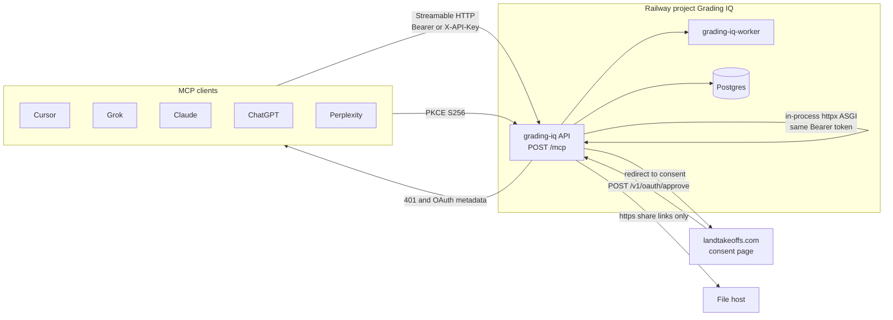

# Technical overview

This repository is the public plugin listing for Land Takeoffs. The process that answers `https://mcp.landtakeoffs.com/mcp` is not in this repository. It is the `grading-iq` service in the private `landtakeoffs/grading-iq` project, deployed on Railway. The registry's `repository` URL points at this listing repo. `server.json` here matches the manifest already published as `com.landtakeoffs/takeoffs` version `1.1.1`. The behaviour below was checked against that hosted process on 21 November 2026 and against the router that serves it. Routes that the MCP router calls directly are named. The combined-takeoff flow after the files are downloaded is an in-process service, and its internal calls are not restated as if they were a single HTTP route.

## What the server does

An authenticated client can:

- Start a sitework takeoff from a civil plan-set PDF, from CAD or terrain files (DWG, DXF, LandXML, or a GeoJSON boundary), or from both.
- Answer a CAD question when the file has more than one plausible boundary or the existing and proposed surfaces are ambiguous.
- Read status, quantities, the credit balance, saved price-list names, and recent takeoffs.
- Create an Excel bid sheet and a PDF summary and receive short-lived download links. CAD takeoffs can also return a project video, still images, a zip, and a 3D viewer link. The tool text says those media files are renders of the takeoff geometry, not generated pictures.
- Hand the user a private upload page when the files are on their computer.

Quantities include the source sheet or file and a confidence level. Lines that could not be determined are returned with a reason. The router caps the `not_determined` array at 25 items and still returns `not_determined_count` for the full number.

A takeoff uses 1 credit. A plan set uses 1 credit per 100 pages. A failed takeoff is not charged. `check_balance` also returns the account's pack catalogue. This overview does not repeat that catalogue.

## Transport

| Item | Observed value |
| --- | --- |
| Protocol | MCP over Streamable HTTP |
| URL | `POST https://mcp.landtakeoffs.com/mcp` (a trailing slash is accepted) |
| `GET /mcp` | `405` with `Allow: POST`. There is no server-sent event stream. |
| Body | One JSON-RPC 2.0 object, or a batch (a JSON array). A response with no reply is HTTP 202. |
| Protocol versions the card advertises | `2025-11-25`, `2025-06-18`, `2025-03-26`, `2024-11-05` |
| Unauthenticated catalogue | `GET https://mcp.landtakeoffs.com/.well-known/mcp/server-card.json` |
| Server card identity | `com.landtakeoffs/takeoffs`, `serverInfo.name` `land-takeoffs`, version `1.1.1` |

`tools/list` returns the 13 tools below. `resources/list` returns one resource, `ui://land-takeoffs/upload-card.html` (`text/html;profile=mcp-app`). `prompts/list` is empty. `initialize` advertises `tools`, `resources`, and the MCP Apps UI extension for that upload card. Tool results are JSON text plus `structuredContent`. A tool failure is `isError: true`, not a JSON-RPC error, except for an unknown tool name (`-32602`).

The published card has an `inputSchema` for every tool and no `outputSchema`. The response fields below are what the router builds.

## Authentication

Both of these are accepted on `POST /mcp`:

- OAuth 2.1 access token: `Authorization: Bearer <token>`
- API key: the same Bearer header, or `X-API-Key`

A missing or rejected credential is HTTP 401:

```
WWW-Authenticate: Bearer realm="grading-iq", resource_metadata="https://mcp.landtakeoffs.com/.well-known/oauth-protected-resource"
```

The body tells the client to sign in or send an API key, and links to `https://www.landtakeoffs.com/gradingiq`. The server card's `authentication.schemes` lists only `oauth2`. The API key is real, and it is absent from that field.

OAuth metadata (fetched without credentials from `https://mcp.landtakeoffs.com`):

| Field | Value |
| --- | --- |
| Issuer | `https://mcp.landtakeoffs.com` |
| Authorization | `GET /oauth/authorize` |
| Token | `POST /oauth/token` |
| Registration | `POST /oauth/register` (RFC 7591) |
| Revocation | `POST /oauth/revoke` (RFC 7009, always 200) |
| Protected resource | `https://mcp.landtakeoffs.com/mcp` |
| Grant types | `authorization_code`, `refresh_token` |
| Response type | `code` |
| PKCE | `S256` only. `plain` is rejected. |
| Token endpoint auth | `none` (public clients; no client secret) |
| Client ID metadata documents | supported (`client_id` may be an https URL) |
| Scope | `takeoffs` |
| Bearer method | `header` |

The authorize redirect sends the user to `https://www.landtakeoffs.com/gradingiq/connect`. The website verifies the Google, Microsoft, or email sign-in and calls `POST /v1/oauth/approve` with the portal service token. The MCP host then returns a one-time code to the client's redirect URI.

Token handling in the API service:

- Authorization-request handles, codes, access tokens, and refresh tokens are stored as SHA-256 hashes. The plaintext is not stored.
- Access tokens are prefixed `giq_at_`. The source default lifetime is 3600 seconds (`oauth_access_ttl_seconds`). The token response includes `expires_in`.
- Refresh tokens are prefixed `giq_rt_` and rotate on every refresh. The source default lifetime is 60 days (`oauth_refresh_ttl_days`).
- Authorization requests last 15 minutes. Codes last 5 minutes, are single use, and are bound to the client and the PKCE verifier. Replaying a code revokes the grant it created.
- API keys are prefixed `gik_live_`. Only the SHA-256 hash is stored. The plaintext is returned once, at creation.
- An OAuth-connected app cannot list or disconnect grants and cannot create API keys. Those account routes reject an OAuth caller. Disconnect is done with the API key on `GET` or `DELETE /v1/oauth/grants`, or with `POST /oauth/revoke`.
- Dynamic registration is limited per IP per day (source default 30) and accepts 1 to 10 redirect URIs. Redirects must be https, or http on localhost / 127.0.0.1 / ::1.
- Production can override the TTL settings. Their production values were not read for this review. The public setup page states the same 1 hour and 60 day figures as the source defaults.

## How a tool call reaches the API

The MCP router does not reimplement takeoff math. After it accepts the credential, it calls the same FastAPI app in-process with `httpx` and an ASGI transport. The base URL on that internal client is `http://grading-iq.internal`. The caller's Bearer token is forwarded, so tenancy and credit checks are the API's checks.

Share links are downloaded by the MCP process before those API calls. Dropbox, Google Drive, and OneDrive or SharePoint links are rewritten to direct-download URLs. The fetch requires `https`, checks that every resolved address is public, re-checks every redirect, and stops at the upload size ceiling (source default 200 MB). The hosted router does not run the tool's JSON Schema before the call. Required links and the `https://` prefix are checked in code; numeric bounds, enums, and `additionalProperties: false` are left to the client.

| Tool | API the router calls |
| --- | --- |
| `check_balance` | `GET /v1/usage` |
| `list_price_lists` | `GET /v1/rate-cards` |
| `list_takeoffs` | `GET /v1/jobs?limit=` |
| `get_upload_page` | No API call. Returns the account page URL. |
| `get_upload_link` | `GET /v1/rate-cards` when `price_list` is set, then an in-process upload-link record |
| `get_takeoff_status` | Intake row for a `takeoff_id`, or `GET /v1/jobs/{job_id}` |
| `get_takeoff_results` | `GET /v1/jobs/{job_id}/result` |
| `get_download_links` | `POST /v1/jobs/{job_id}/deliverables` for `xlsx` and `pdf`, then `GET /v1/deliverables/{id}`, then `POST /v1/jobs/{job_id}/media` and `GET /v1/jobs/{job_id}/viewer` |
| `start_plan_set_takeoff` | Download the https link, then `POST /v1/quick-pdf-read` |
| `start_cad_takeoff` | `POST /v1/projects`, `POST /v1/projects/{id}/files` per file, then prepare, then `POST /v1/projects/{id}/jobs` when prepare is ready |
| `start_takeoff` | Download the https links, then the in-process takeoff flow |
| `start_takeoff_from_chat_files` | Download each attachment `download_url`, then the same takeoff flow |
| `answer_cad_question` | `POST /v1/projects/{id}/scope`, `PUT /v1/projects/{id}/surfaces/confirm`, `PUT /v1/projects/{id}/earthwork-inputs`, then prepare and `POST /v1/projects/{id}/jobs` |

Start tools that download a link (`start_plan_set_takeoff`, `start_takeoff`, `start_cad_takeoff`, `start_takeoff_from_chat_files`) wait up to 20 seconds. If the download is still running they return `status: "downloading"` and a `takeoff_id`. A download with no live task after 30 minutes is reported failed and is not charged.

A price list is matched by name or id against `GET /v1/rate-cards`. An unknown name is an error before the download starts. The id is sent as `rate_card_id`. Prices are written into the Excel workbook only.

## Hosting

Checked against the live host, without changing it:

| Item | Observed |
| --- | --- |
| HTTP server header | `railway-hikari` |
| DNS | `mcp.landtakeoffs.com` is a CNAME to `y7ht5oge.up.railway.app` |
| Railway service | `grading-iq`, production environment, custom domain `mcp.landtakeoffs.com`, port 8000 |
| Railway-generated URL | `https://grading-iq-production.up.railway.app` still answers `POST /mcp` with the same 401 and points OAuth metadata at `https://mcp.landtakeoffs.com` |
| Same Railway project | `grading-iq-worker` (no public domain) and Postgres |
| TLS | Let's Encrypt certificate for `mcp.landtakeoffs.com` only |
| Edge that answered | `x-railway-edge: jfk1` (the edge, not a claim about where files are stored) |

The public setup page says files and reports are stored in the United States. Object storage is configured on the service; the bucket region was not read. The worker has no public HTTP domain.



## Tools

Annotations on the public card: `readOnlyHint`, `destructiveHint` (false on every tool), and `openWorldHint` (true on the four tools that fetch a URL the caller supplies).

### `check_balance`

Read-only. No arguments.

Response fields: `credits_available`, `credits_purchased`, `credits_used`, `buy_more`, `credit_packs`, `pricing`, `pricing_url`. The first three come from `GET /v1/usage` (`balance`, `purchased`, `consumed`).

### `list_price_lists`

Read-only. No arguments.

Response: `price_lists[]` with `name` and `items` (the card's entry count), plus a note that a name passed as `price_list` prices the Excel workbook only.

### `list_takeoffs`

Read-only.

| Input | Schema |
| --- | --- |
| `limit` | integer, minimum 1, maximum 50, optional |

The router treats a missing or zero limit as 10, then clamps to 1..50. Response: `takeoffs[]` with `job_id`, `project`, `type` (`plan set` when the job kind is `pdf_scope`, otherwise `CAD`), `status`, `created_at`.

### `get_upload_page`

Read-only. No arguments.

Response: `upload_page` (`https://www.landtakeoffs.com/gradingiq`) and short instructions.

### `get_upload_link`

Not read-only. Creates a link.

| Input | Schema |
| --- | --- |
| `project_name` | string, optional |
| `strip_depth_in` | number, optional. This schema has no minimum or maximum. The same field on the start tools is 0..36. |
| `customer_ref` | string, optional |
| `price_list` | string, optional |

The public description says the link lasts 24 hours, is good for one takeoff, and does not require a sign-in. The router returns a `takeoff_id` that `get_takeoff_status` can poll. The handler also accepts earthwork fields that are not in this tool's schema, if a client sends them, because the schema is not enforced.

### `get_takeoff_status`

Read-only.

| Input | Schema |
| --- | --- |
| `takeoff_id` | string, optional |
| `job_id` | string, optional |

Neither field is required by the schema. The router rejects a call that has neither. A `job_id` wins when both are sent.

Response for a job: `job_id`, `status`, `progress_pct`, and `next` while it is running. `succeeded` points at the results and download tools. `failed` and `cancelled` include `reason` and `charged: false`.

Response for a `takeoff_id` uses the intake row. Status values the router returns include `downloading`, `waiting_for_upload`, `expired`, `failed`, `needs_answer`, and, once jobs exist, the job status or `running`, `succeeded`, `failed`, or `partly_failed`. The tool description says "finished"; the status string for a completed job is `succeeded`.

### `get_takeoff_results`

Read-only.

| Input | Schema |
| --- | --- |
| `takeoff_id` | string, optional |
| `job_id` | string, optional |
| `division` | string, optional. Case-insensitive substring match on the line's division. |

The schema does not require an id. The router does. Results are available once the intake has a job id.

Response: `job_id`, `kind` (`plan_set_read` or `measured_takeoff`), `page_count`, `line_count`, `lines[]`, `not_determined[]`, `not_determined_count`, `note`. A measured result may include `earthwork` (`cut_cy`, `fill_cy`, `net_cy`, `direction`, `analysis_area_ac`, `basis`). Lines have `division`, `description`, `quantity`, `unit`, `source`, `confidence`, and on measured lines `basis`. Plan-set `source` is `Sheet <source_sheet>` when the sheet is present.

### `get_download_links`

Not read-only. It creates and stores the Excel and PDF deliverables.

| Input | Schema |
| --- | --- |
| `takeoff_id` | string, optional |
| `job_id` | string, optional |

Response: `excel_bid_sheet`, `pdf_summary`, and `note` (links expire after a short time; call again for fresh ones). The public setup page says download links expire after 1 hour. That duration is not set in the MCP router; the deliverable service sets it.

When media exists, the same response can include `project_video`, `project_images`, `download_all_zip`, `site_viewer_3d`, and `site_viewer_share_link`. A plan-set-only takeoff has no CAD to render. The viewer field's own text says the private viewer link is for the account owner and is valid 12 hours.

### `start_plan_set_takeoff`

Not read-only. Open world (it fetches a URL).

| Input | Schema |
| --- | --- |
| `plan_set_url` | string, required |
| `project_name` | string, optional, stored up to 255 characters |
| `customer_ref` | string, optional, stored up to 128 characters |
| `price_list` | string, optional |

The link must be `https`. A non-PDF filename gets a `.pdf` suffix before upload. Response when the download finishes inside the wait: `status: "started"`, `job_id`, `file`, `next`, and `takeoff_id`. Otherwise `status: "downloading"` and `takeoff_id`.

### `start_cad_takeoff`

Not read-only. Open world.

| Input | Schema |
| --- | --- |
| `file_urls` | array of strings, required, 1 to 20 items |
| `project_name` | string, optional |
| `strip_depth_in` | number 0..36, optional |
| `shrink_pct` | number 0..40, optional. Omitted means no shrink is applied, and the report says so. |
| `topsoil_reuse_pct` | number 0..100, optional |
| `pavement_section_depth_ft` | number 0..4, optional |
| `storm_rcp_class` | `III`, `IV`, or `V`, optional. Applied only to unlabeled concrete storm pipe. |
| `water_pvc_type` | `C900`, optional. Applied only to unlabeled PVC water pipe. |
| `customer_ref` | string, optional |
| `price_list` | string, optional |

If prepare cannot choose a boundary or the surfaces, the result is `status: "needs_answer"`, `project_id`, and `questions` for `answer_cad_question`. `status: "analyzing"` means the drawing is still being read.

### `start_takeoff`

Not read-only. Open world. The schema requires no property. The router requires `cad_file_url`, `plan_set_url`, or both, and it rejects reference drawings sent without `cad_file_url`.

| Input | Schema |
| --- | --- |
| `cad_file_url` | string, optional |
| `cad_reference_urls` | array of strings, maximum 4, optional |
| `plan_set_url` | string, optional |
| Earthwork and price-list fields | Same bounds as `start_cad_takeoff` |

With both files, earthwork comes from the CAD and the other divisions come from the plans, in one report. An ambiguous CAD file returns the same question shape as `start_cad_takeoff`.

### `start_takeoff_from_chat_files`

Not read-only. Open world. The schema requires no property. The router requires `plan_set`, `cad_files`, or both. This is the ChatGPT attachment path. The card marks `plan_set` and `cad_files` as file parameters.

| Input | Schema |
| --- | --- |
| `plan_set` | object, optional. Requires `download_url` and `file_id`. Optional `mime_type`, `file_name`. No extra properties. |
| `cad_files` | array of the same object, maximum 5. The drawing first, then files it references. |
| Earthwork and price-list fields | Same bounds as `start_cad_takeoff` |

Files that are only on the user's computer are not this tool. Use `get_upload_link`.

### `answer_cad_question`

Not read-only. Closed world.

| Input | Schema |
| --- | --- |
| `project_id` | string, required |
| `boundary_id` | string, optional |
| `existing_surface_id` | string, optional |
| `proposed_surface_id` | string, optional |
| `strip_depth_in` | number 0..36, optional |
| `shrink_pct` | number 0..40, optional |
| `topsoil_reuse_pct` | number 0..100, optional |

Sending one surface id without the other is an error. The response is the prepare result: `started` (with `job_id`), `needs_answer`, or `analyzing`.

## Registry and schema mismatches

Checked on 21 November 2026 against `https://registry.modelcontextprotocol.io/v0.1/servers/com.landtakeoffs%2Ftakeoffs/versions` and the live server card.

| Item | What is published |
| --- | --- |
| Latest registry version | `1.1.1`, `isLatest: true`, published 2026-10-25. Repository URL is this repo. Remote is `https://mcp.landtakeoffs.com/mcp`, type `streamable-http`. |
| Previous registry version | `1.1.0` is still `active` and `isLatest: false`. Its description differs, and it has no `repository` field. |
| Plugin manifests before this change | `.cursor-plugin/plugin.json` and `.grok-plugin/plugin.json` said version `1.0.0`. This repo had no `server.json`. |
| This change | Both plugin manifests and `server.json` say `1.1.1`, matching the live card and the latest registry entry. Nothing was published to the registry. |
| Card versus registry schema | The card uses `https://static.modelcontextprotocol.io/schemas/v1/server-card.schema.json`. The registry manifest uses the `2025-12-11` server schema. They are different document types. The version, name, and remote URL agree. |
| Card auth versus the server | The card lists only `oauth2`. API keys work and are described by the 401 body. |
| Schemas that do not match the router's checks | `start_takeoff` and `start_takeoff_from_chat_files` have no `required` array. `get_takeoff_status`, `get_takeoff_results`, and `get_download_links` do not require an id. `get_upload_link.strip_depth_in` has no bounds. The router checks the links and the ids itself and does not apply the JSON Schema. |
| Public setup page | <https://www.landtakeoffs.com/ai> lists 11 tools. It does not list `start_takeoff_from_chat_files` or `list_price_lists`, which are on the live card. |
| Status wording | The `get_takeoff_status` description says "finished". The status value for a completed job is `succeeded`. |
| Cursor versus Grok config | `mcp.json` has only `url`. `.mcp.json` also sets `"type": "http"`. Both use the same URL and neither sets headers. |

`contract/server-card.json` is a copy of the public card, saved so the tests do not depend on the network. It is the card as served, including the gaps above.
